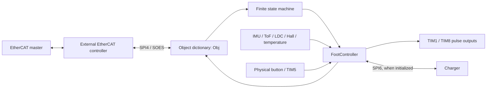

# Architecture

[Home](Home.md) · [Hardware](Hardware.md) · [Development](Development.md)

## Repository map

| Location | Responsibility |
| --- | --- |
| [`Core/Src/main.cpp`](../Core/Src/main.cpp) | Entry point, global `Obj` and `controller`, EtherCAT callbacks, HAL callbacks, fatal error handler |
| [`Core/Inc`](../Core/Inc) / [`Core/Src`](../Core/Src) | CubeMX peripheral configuration, interrupt handlers, HAL setup, and system support |
| [`Libs/Controller`](../Libs/Controller) | `FootController`, charger protocol, LED patterns, EEPROM access, and SWO utilities |
| [`Libs/FSM`](../Libs/FSM) | Control-word decoding, state transitions, status-word constants, and error codes |
| [`Libs/Sensors`](../Libs/Sensors) | BNO086, LDC1101, TMAG5273, TMF8829, temperature lookup, and ToF firmware image |
| [`Libs/SOES_Wrapper`](../Libs/SOES_Wrapper) | SOES build, SPI ESC hardware layer, and object dictionary |
| `Libs/SOES_Wrapper/SOES` | Git submodule containing the EtherCAT slave stack |
| [`Drivers`](../Drivers) | Vendored STM32 HAL and CMSIS code |
| [`cmake`](../cmake) | ARM toolchains, CubeMX source list, generated version header logic |
| [`MagneckoFoot_Header.ioc`](../MagneckoFoot_Header.ioc) | CubeMX MCU, clock, and peripheral configuration |
| [`STM32H725XG_FLASH.ld`](../STM32H725XG_FLASH.ld) | Flash and SRAM layout, including DMA-oriented sections |

## Data flow

## Startup

1. `main()` configures the MPU, HAL, clocks, GPIO, DMA/BDMA, I2C, SPI, timers, ADC, and CRC.
2. `FootController::init()` configures LEDs and pulse timers, then enables the gate drivers by driving `GD_nEN` low.
3. The FSM callbacks are bound. Ten force parameters are read from the I2C EEPROM; defining `EEPROM_WRITE` also writes the embedded image first.
4. The external EtherCAT controller is reset. Firmware waits for `EEPROM_LOADED` **without a timeout**, then calls `ecat_slv_init()`.
5. The Git version string is copied into the storage of `Force_Estimate_Params`; `EPM_Number` is set from the generated header.
6. The IMU, four LDCs, temperature ADC, Hall bus, and ToF sensor are initialized and acquisition starts. Most sensor initialization failures become warning flags.
7. Charger initialization runs only when `USE_BATTERIES` is absent. The control and IMU timers start; TIM6 receives the pulse dead-time period.
8. `SWD_Init()` enables trace support. The foreground loop repeatedly reads Hall sensors in order 3, 2, 1, 0.

## Execution contexts

| Context | Nominal rate / trigger | Work |
| --- | --- | --- |
| Foreground loop | As fast as Hall transfers finish | Read four Hall magnitudes using DMA followed by a busy wait |
| TIM2 | 1 kHz | `runControl()`, `runCommunication()`, start one LDC read |
| TIM4 | 400 Hz | `imu.update()` |
| TIM5 | About 1 s after button press | Request and directly attempt a demagnetization pulse |
| TIM6 | About 100 ms after an accepted pulse | Clear `dead_time_active` |
| GPIO EXTI | Sensor/button edges | Count IMU messages, clear ToF interrupt, start/stop button timer |
| SPI completion | Transfer completion | Decode sensor data, advance the LDC ring, validate charger CRC |

These rates follow [timer setup](../Core/Src/tim.c) with nominal 275 MHz timer clocks. They do not guarantee sensor freshness at the same rates. Each LDC is visited roughly every fourth control tick, assuming successful completion.

`runControl()` executes the state action and background telemetry/error update before `runCommunication()` polls SOES. New network commands therefore normally affect a later control invocation. `cb_get_inputs()` currently performs command edge detection even though SOES calls it while preparing master inputs; `cb_set_outputs()` copies the status word. Follow the actual functions rather than inferring their behavior from their names.

## Shared state and memory

`Obj` is the C-compatible object storage declared in [`utypes.h`](../Libs/SOES_Wrapper/autogenerated/utypes.h). The SOES dictionary points into it. Sensor buffers and controller members are shared across foreground and interrupt contexts; there is no RTOS or locking layer.

The controller and several buffers use `.RAM`; charger frames use `.RAM_D3`. These linker sections are `NOLOAD`. Review construction, initialization, DMA accessibility, and cache behavior whenever changing their placement. See [Hardware](Hardware.md) for the linker map.

The control ISR also performs blocking EtherCAT SPI operations and floating-point force estimation with a dynamically allocated deque. Changes to this path should be evaluated for interrupt latency and transfer completion behavior on hardware.
