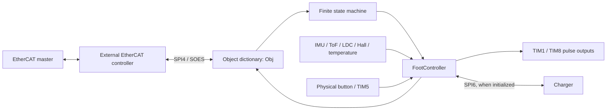

# Architecture

[Home](Home.md) · [Hardware](Hardware.md) · [Development](Development.md)

## Repository map

| Location | Responsibility |
| --- | --- |
| [`Core/Src/main.cpp`](../Core/Src/main.cpp) | Entry point, global `Obj` and `controller`, EtherCAT callbacks, HAL callbacks, fatal error handler |
| [`Core/Inc`](../Core/Inc) / [`Core/Src`](../Core/Src) | CubeMX peripheral configuration, interrupt handlers, HAL setup, and system support |
| [`Libs/Controller`](../Libs/Controller) | `FootController`, charger protocol, LED patterns, EEPROM access, and SWO utilities |
| [`Libs/Runtime`](../Libs/Runtime) | Static tasks, sensor queues, completion waits, scheduling/freshness diagnostics |
| [`Libs/FreeRTOS-Kernel`](../Libs/FreeRTOS-Kernel) | Pinned V11.2.0 kernel and GCC Cortex-M7 port |
| [`Libs/FSM`](../Libs/FSM) | Control-word decoding, state transitions, status-word constants, and error codes |
| [`Libs/Sensors`](../Libs/Sensors) | BNO086, LDC1101, TMAG5273, TMF8829, temperature lookup, and ToF firmware image |
| [`Libs/SOES_Wrapper`](../Libs/SOES_Wrapper) | SOES build, SPI ESC hardware layer, and object dictionary |
| `Libs/SOES_Wrapper/SOES` | Git submodule containing the EtherCAT slave stack |
| [`Drivers`](../Drivers) | Vendored STM32 HAL and CMSIS code |
| [`cmake`](../cmake) | ARM toolchains, CubeMX source list, generated version header logic |
| [`MagneckoFoot_Header.ioc`](../MagneckoFoot_Header.ioc) | CubeMX MCU, clock, and peripheral configuration |
| [`STM32H725XG_FLASH.ld`](../STM32H725XG_FLASH.ld) | Flash and SRAM layout, including DMA-oriented sections |

## Data flow

## Startup

1. `main()` configures the MPU, HAL, clocks, GPIO, DMA/BDMA, I2C, SPI, timers, ADC, and CRC.
2. `App_Start()` creates static tasks/queues and starts FreeRTOS. The service task runs `FootController::init()` while workers wait for readiness. Initialization configures LEDs and pulse timers, then enables the gate drivers by driving `GD_nEN` low.
3. The FSM callbacks are bound. Ten force parameters are read from the I2C EEPROM; defining `EEPROM_WRITE` also writes the embedded image first.
4. The external EtherCAT controller is reset. Firmware waits up to 2 seconds for `EEPROM_LOADED`, then calls `ecat_slv_init()` with bounded transport/DL-status polling.
5. The Git version string is copied into the storage of `Force_Estimate_Params`; `EPM_Number` is set from the generated header.
6. The IMU, four LDCs, temperature ADC, Hall bus, and ToF sensor are initialized and acquisition starts. Most sensor initialization failures become warning flags.
7. Charger initialization runs with `EPM_USE_BATTERIES=OFF`. TIM6 receives the pulse dead-time period.
8. After initialization, the service task releases workers and starts TIM2. The foreground main loop is replaced by the scheduler; `SWD_Init()` runs before scheduler startup.

## Execution contexts

The [RTOS runtime](RTOS.md) defines five application tasks. TIM2 posts control
and acquisition releases at nominal 1 kHz. IMU/ToF EXTI and I/O completion
callbacks signal tasks. Button hold and dead-time callbacks post control
events. TIM1/TIM8 remain responsible for pulse edges. TIM4 is not started.

Control runs the FSM and telemetry update before EtherCAT service, retaining
the existing command phase order. SOES alone owns `Obj` in that same task;
callbacks retain their original command/status behavior. Fresh sensor snapshots
arrive through one-element queues. A task release is not proof of a new sample
or a met execution deadline.

SOES is polled once per completed cyclic invocation. Its watchdog accounting
uses elapsed HAL milliseconds, while missed task releases coalesce. TIM7
provides HAL milliseconds independently of the FreeRTOS SysTick and checks
for a completed-control heartbeat older than 100 ms.

## Shared state and memory

Control owns the FSM, pulse requests and exported process data. Each sensor bus
has one task owner. Services owns LED/charger/CRC operations. Sensor snapshots
carry timestamps and validity; stale data raises a warning without changing
PDO layout. See [RTOS runtime](RTOS.md) for rates, priorities, stacks and limits.

Static task stacks and kernel objects use DTCM. DMA-visible `.RAM` and BDMA
`.RAM_D3` remain `NOLOAD`, zeroed before C++ construction. **SPI6 BDMA wire
buffers remain in D3 SRAM**, and DMA never receives a task-stack buffer. The MPU
marks both DMA windows noncacheable. [Hardware](Hardware.md) lists regions.

FSM dispatch uses member-function pointers and the force moving average has
fixed storage. C++ action bindings allocate during startup; periodic dispatch
and filtering do not allocate. Fatal handling uses immediate hardware actions
and halts without scheduler or bus waits. Hardware verification remains needed.
